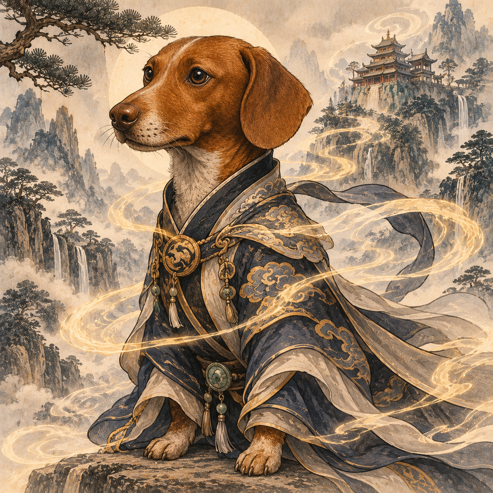
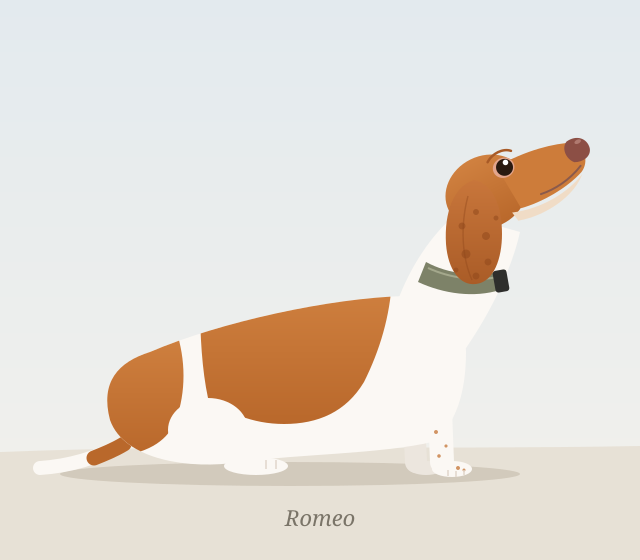

# Romeo, the Undying Hound

<em>Romeo, before the fall</em>

A serialized xianxia LitRPG about Romeo, a small red-and-white piebald dachshund who is also an immortal cultivator. A new chapter is written daily.

## Files

- [Series Bible](00-series-bible.md): fixed canon and style rules
- [Continuity Ledger](01-continuity-ledger.md): current state of the story, rewritten after each chapter
- [Notes for Next Chapter](02-notes-for-next-chapter.md): plot nudges for the next chapter

## Art

 

<em>Left: the tattooed master. Right: the real Romeo.</em>

## Chapters

- [Chapter 1: The Oldest Puppy in the World](chapters/001-the-oldest-puppy-in-the-world.md)
- [Chapter 2: Terms of the Arrangement](chapters/002-terms-of-the-arrangement.md)
- [Chapter 3: Go to Ground](chapters/003-go-to-ground.md)
- [Chapter 4: Small Enough to Miss](chapters/004-small-enough-to-miss.md)
- [Chapter 5: The Name He Answers To](chapters/005-the-name-he-answers-to.md)
- [Chapter 6: Rough Water](chapters/006-rough-water.md)
- [Chapter 7: Upstream](chapters/007-upstream.md)
- [Chapter 8: Stop Trying to Be Tall](chapters/008-stop-trying-to-be-tall.md)
- [Chapter 9: Small Things in the Cold](chapters/009-small-things-in-the-cold.md)
- [Chapter 10: Three, Then Two](chapters/010-three-then-two.md)
- [Chapter 11: Knock Louder](chapters/011-knock-louder.md)
- [Chapter 12: Water Goes Downhill](chapters/012-water-goes-downhill.md)
- [Chapter 13: Only the Cold](chapters/013-only-the-cold.md)
- [Chapter 14: Things That Are Mine](chapters/014-things-that-are-mine.md)
- [Chapter 15: The Name He Comes To](chapters/015-the-name-he-comes-to.md)
- [Chapter 16: A Needle Among Needles](chapters/016-a-needle-among-needles.md)
- [Chapter 17: What the Stone Keeps](chapters/017-what-the-stone-keeps.md)
- [Chapter 18: A Pebble in Slow Water](chapters/018-a-pebble-in-slow-water.md)
- [Chapter 19: The Scent of What Is Missing](chapters/019-the-scent-of-what-is-missing.md)
- [Chapter 20: Three Knocks, Then Two](chapters/020-three-knocks-then-two.md)
- [Chapter 21: Knock Louder](chapters/021-knock-louder.md)
- [Chapter 22: Don't Answer That](chapters/022-dont-answer-that.md)
- [Chapter 23: The Bucket Book](chapters/023-the-bucket-book.md)
- [Chapter 24: A Coat Name](chapters/024-a-coat-name.md)
- [Chapter 25: Borrowed Feet](chapters/025-borrowed-feet.md)
- [Chapter 26: No Laugh in It](chapters/026-no-laugh-in-it.md)
- [Chapter 27: Below the Grating](chapters/027-below-the-grating.md)
- [Chapter 28: A Hand's Width](chapters/028-a-hands-width.md)
- [Chapter 29: Not One Word Out Loud](chapters/029-not-one-word-out-loud.md)
- [Chapter 30: The Wrong Way Round](chapters/030-the-wrong-way-round.md)
- [Chapter 31: The Long White Shoulder](chapters/031-the-long-white-shoulder.md)
- [Chapter 32: Weight in the Wrong Places](chapters/032-weight-in-the-wrong-places.md)
- [Chapter 33: A Whole Pot](chapters/033-a-whole-pot.md)
- [Chapter 34: What's in the Pockets](chapters/034-whats-in-the-pockets.md)
- [Chapter 35: Marked Present](chapters/035-marked-present.md)
